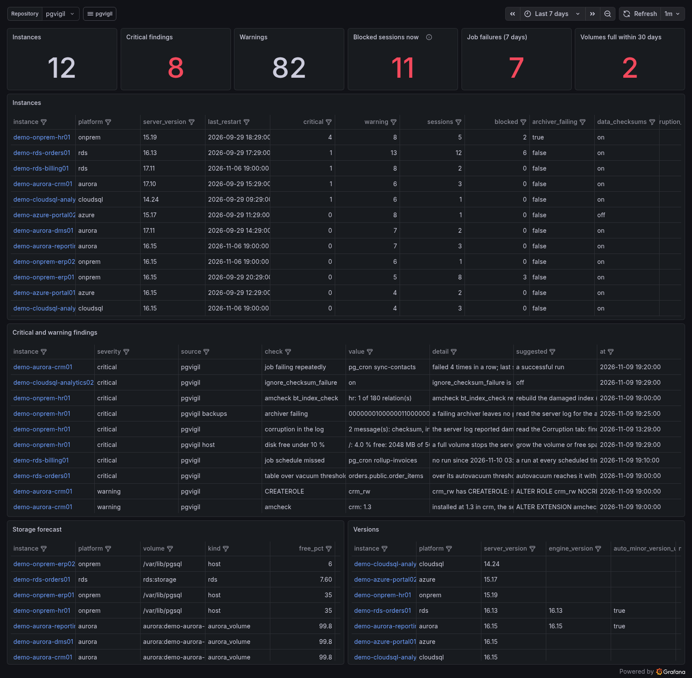
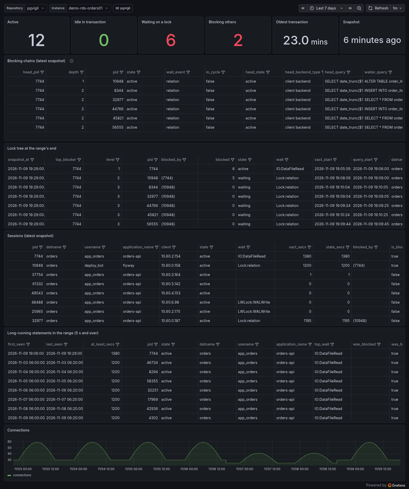
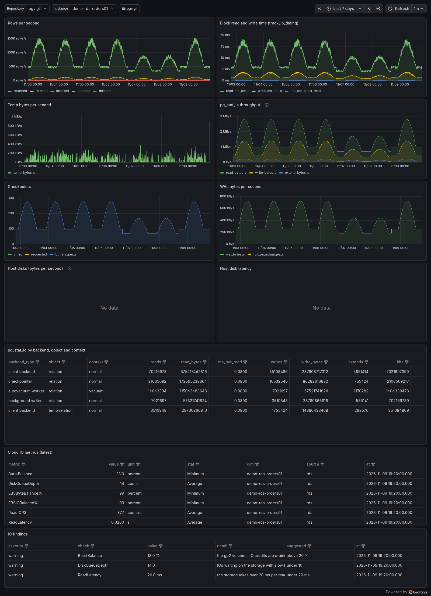

# Grafana dashboards for pgvigil

pgvigil's own web UI needs nothing else. Grafana is optional, for a site that already runs it and wants pgvigil's data beside its other dashboards. `deploy/grafana/` holds a provisioned set of 13 dashboards and the two provisioning files that load them. Nothing in pgvigil depends on Grafana, and Grafana gets nothing that the web UI does not already show.

| Dashboard | uid | What it shows |
|---|---|---|
| Fleet summary | `pgvigil-fleet` | instances, critical and warning findings, blocked sessions, job failures, volumes close to full; one row per instance with links to its overview |
| Instance overview | `pgvigil-instance` | version, last restart, sessions, CPU; connections per database, transactions per second, cache hit ratio, temp files and deadlocks; the instance's findings and host |
| Running queries and blocking | `pgvigil-activity` | the latest activity snapshot: the blocking chains with their head, the lock tree at the range's end, every session, the long statements of the range |
| Statements | `pgvigil-statements` | top statements over the range by time, calls, IO, mean, rows, temp or WAL (pg_stat_statements deltas); the server log's slow statements: totals, per day, by shape |
| Counters and IO | `pgvigil-io` | rows per second, block read and write time, temp bytes, pg_stat_io (16+), checkpoints, WAL, the host's disks, the cloud's IO metrics, the IO findings |
| Replication | `pgvigil-replication` | senders, receivers, slots, publications and Aurora replicas of the fleet with their lag, the replication checks, the oldest xmin holders |
| Jobs | `pgvigil-jobs` | pg_cron and pgAgent jobs of the fleet: failures, missed runs, runs over their average, the failed runs of the range |
| Storage | `pgvigil-storage` | every volume with days until full, the instance's volumes, database and table growth, wraparound, the storage and table checks |
| DMS | `pgvigil-dms` | AWS DMS tasks: latency, the drain ETA, spilling, table states, the DMS checks |
| Backups | `pgvigil-backups` | WAL archiving and the platform's backups: the archiver, the restore window, snapshots, the backup checks and findings |
| Corruption | `pgvigil-corruption` | data checksums, the corruption events from the server logs, the amcheck runs, the corruption findings |
| Waits | `pgvigil-waits` | the active sessions by wait now (fleet and instance), the lock tree, the top waits of the range's long statements, deadlocks and conflicts |
| Indexes | `pgvigil-indexes` | the index advisor's findings (invalid, unused, redundant, missing) with the suggested action, the statements with the most block IO |

Each dashboard links to the others through the `pgvigil` menu at the top, keeping the time range and the instance. The instance column of a fleet table opens that instance's overview.

Three of them, as `scripts/proof-grafana.sh` captured them on the demo repository (Grafana 12.4.3, last 7 days, instance `demo-rds-orders01`):







## What the dashboards read

The panels read only the repository's views and read functions (`pgvigil.findings`, `pgvigil.activity_latest`, `pgvigil.dbstats_rate()`, `pgvigil.top_statements_by()`, `pgvigil.volume_forecast()` and the rest). They never read a table directly, so a later release can change its tables without breaking the dashboards. `scripts/proof-grafana.sh` checks every name in every panel against the catalog.

The query text Grafana shows is the text the collector stored, after the `query_text` policy was applied (`full`, `normalized` or `none`). A site that stores no text sees query ids and no text, in Grafana as in the UI.

Two gaps, named here so nobody looks for them: the repository has no read view for the wait samples over time or for the session counts over time (the UI reads those tables itself). The Waits dashboard therefore shows the waits now and the waits of the range's long statements, and the session panels count connections from `pg_stat_database`.

## 1. A reader login for Grafana

Make the login on the repository's server as the repository owner. It is a member of `pgvigil_reader` and nothing else, read-only by default, with a statement timeout:

```sql
CREATE ROLE pgvigil_grafana LOGIN PASSWORD '<a long random password>' IN ROLE pgvigil_reader;
ALTER ROLE pgvigil_grafana SET default_transaction_read_only = on;
ALTER ROLE pgvigil_grafana SET statement_timeout = '30s';
GRANT CONNECT ON DATABASE pgvigil TO pgvigil_grafana;
```

`pgvigil_reader` cannot call the UI's password function or read the UI users, and it cannot write: an INSERT, UPDATE or DELETE fails with permission denied. On RDS and Aurora, IAM authentication works the same way (`GRANT rds_iam TO pgvigil_grafana` and no password), if the site's Grafana supports it. Require TLS for this login in `pg_hba.conf` (`hostssl`) when Grafana runs on another host.

## 2. The datasource

`deploy/grafana/provisioning/datasources/pgvigil.yaml` defines a PostgreSQL datasource with the uid `pgvigil` (the type `grafana-postgresql-datasource`, Grafana 10.3 and later). It reads five variables from Grafana's environment, so no password is written into the file:

| Variable | Example |
|---|---|
| `PGVIGIL_GRAFANA_HOST` | `repo.example.internal:5432` |
| `PGVIGIL_GRAFANA_DATABASE` | `pgvigil` |
| `PGVIGIL_GRAFANA_USER` | `pgvigil_grafana` |
| `PGVIGIL_GRAFANA_PASSWORD` | the login's password (from the site's secret store) |
| `PGVIGIL_GRAFANA_SSLMODE` | `verify-full` (`require` at least; `disable` only on loopback) |

Copy it to `/etc/grafana/provisioning/datasources/`. The dashboards pick the datasource through their `Repository` variable, so a site with an existing datasource of another name can choose it there instead.

## 3. The dashboards

```sh
sudo install -d /var/lib/grafana/dashboards/pgvigil
sudo install -m 0644 deploy/grafana/dashboards/*.json /var/lib/grafana/dashboards/pgvigil/
sudo install -m 0644 deploy/grafana/provisioning/dashboards/pgvigil.yaml /etc/grafana/provisioning/dashboards/
sudo systemctl restart grafana-server
```

The dashboards appear in a `pgvigil` folder. They are provisioned read-only (`allowUiUpdates: false`), so a new pgvigil release replaces the JSON without fighting a hand edit. To change a dashboard for the site, save a copy under another uid. With Docker, mount the same three paths, as `scripts/proof-grafana.sh` does.

## On a closed network

The dashboards use only Grafana's built-in panels (stat, table, time series, bar gauge, pie chart) and the built-in PostgreSQL datasource. They need no plugin, no download and no outbound call. Grafana itself checks for updates and fetches a news feed unless told not to. On an air-gapped or government network, set:

```ini
[analytics]
reporting_enabled = false
check_for_updates = false
check_for_plugin_updates = false
[news]
news_feed_enabled = false
```

(or `GF_ANALYTICS_REPORTING_ENABLED=false`, `GF_ANALYTICS_CHECK_FOR_UPDATES=false`, `GF_ANALYTICS_CHECK_FOR_PLUGIN_UPDATES=false`, `GF_NEWS_NEWS_FEED_ENABLED=false`).

## The proof

`scripts/proof-grafana.sh` seeds a demo repository (`pgvigil demo`) in a scratch database and makes a reader login as in section 1. It starts a Grafana container provisioned from these files, then checks:

- the datasource answers its health check;
- all 13 dashboards load in the `pgvigil` folder;
- every panel's query runs through Grafana's query API for every demo instance without an error;
- every panel returns rows for some instance (the one exception is 'Running now', because no job is running in the demo);
- a write through the reader login is refused;
- a headless Chromium takes a screenshot of every dashboard.

```sh
PGVIGIL_ADMIN_DSN="host=127.0.0.1 user=postgres" scripts/proof-grafana.sh
```
